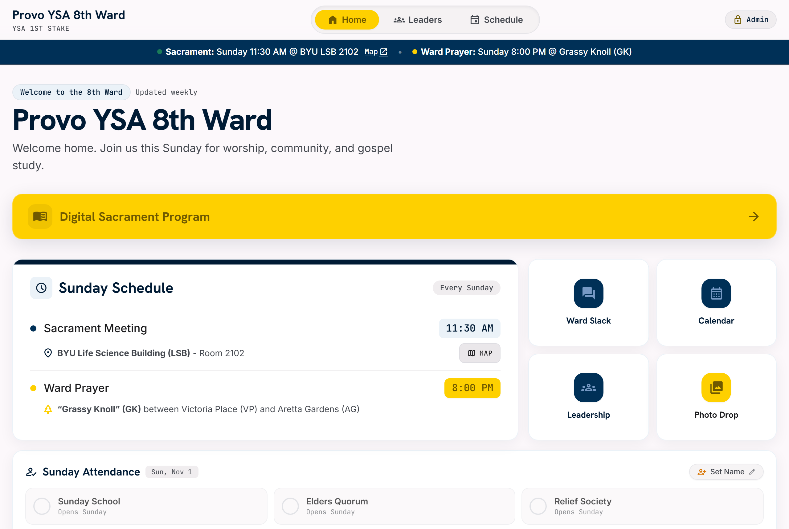
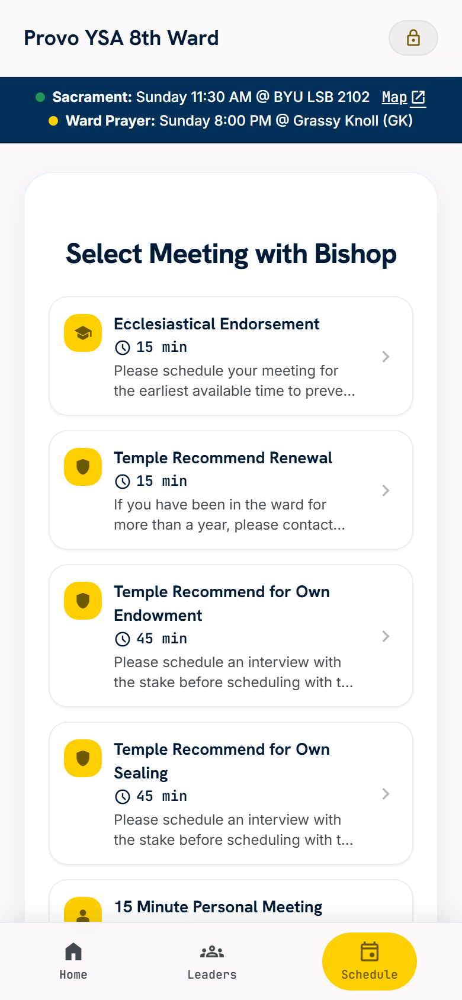
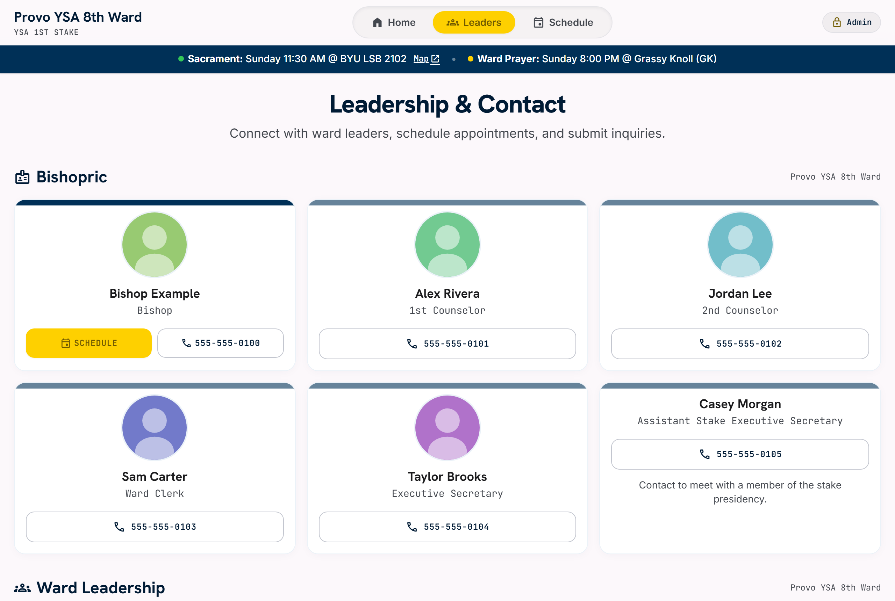
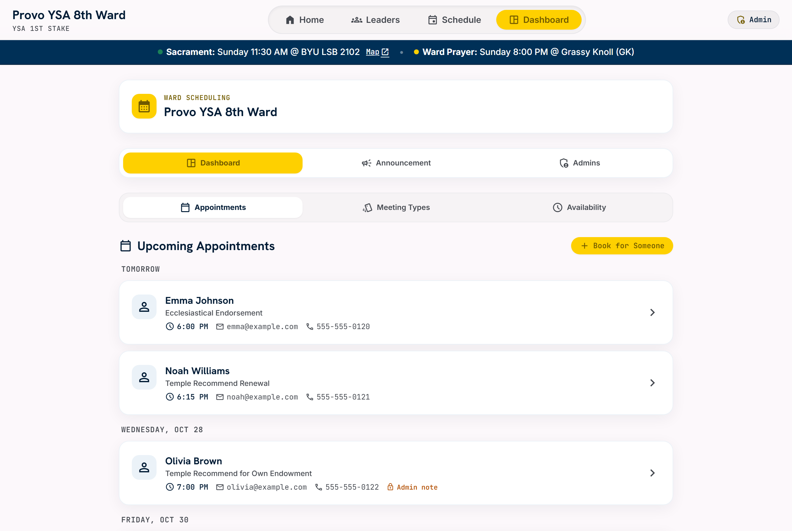
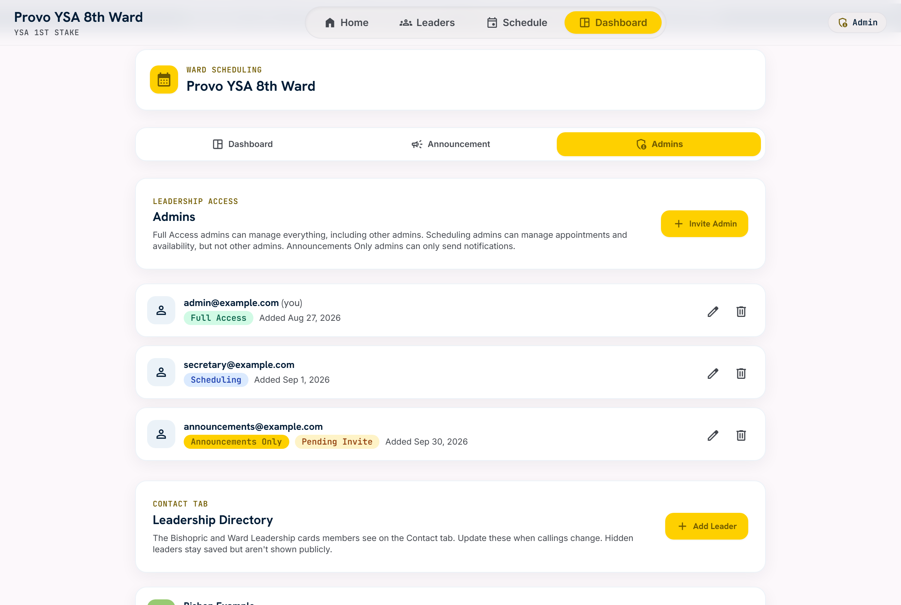

# Provo YSA 8th Ward — Website & Scheduling Platform

A full-stack Progressive Web App built for a real congregation: a public ward website with an integrated self-service appointment scheduler, an admin portal for leadership, and an automated email/push reminder pipeline — all running in production today.

**Live site:** [provo8ward.vercel.app](https://provo8ward.vercel.app)

<p>
  
  
</p>

> Screenshots use placeholder people and appointments. Real member and leader data never leaves the production database.

<details>
<summary><b>More screenshots</b> (leadership directory, admin dashboard, role management)</summary>

| Leadership directory (loaded from Postgres) | Admin appointment dashboard |
|---|---|
|  |  |

| Role-based admin management + directory editor |
|---|
|  |

</details>

---

## What it does

**For members**
- Ward info hub — sacrament meeting times, building address/map, leadership directory, quorum/organization contacts, and live announcements
- Self-service appointment booking with Bishopric/Executive Secretary — pick a meeting type, see real availability by date, book a slot, and get an instant calendar invite (`.ics` download + "Add to Google Calendar" link)
- Cancel or reschedule an appointment later via a secure, token-based link — no login required
- Installable as a PWA (works offline for the app shell, add-to-home-screen, push notifications for reminders)

**For leadership (admin portal)**
- Email/password authentication with role-based access (`full_access`, `scheduling_access`, `announcements_only`)
- Manage meeting types, weekly availability windows, and one-off date overrides
- Dashboard of upcoming/past appointments with attendee contact info, reschedule/cancel controls
- Push broadcast announcements to subscribed devices
- "Book on behalf of" flow for members who call or stop by in person
- Leadership directory editor — add/edit/hide leaders and upload photos (resized in the browser before upload) when callings change, no code deploy needed

**Automated reminders**
- A GitHub Actions cron job pings a Vercel serverless function every 5 minutes
- It finds confirmed appointments starting in ~24 hours or ~30 minutes, emails a reminder (with cancel/reschedule/calendar links), sends a push notification if subscribed, and marks the appointment so it's never reminded twice

---

## Architecture

```
┌─────────────────────┐        ┌──────────────────────────┐        ┌─────────────────────┐
│  Browser / PWA       │◄──────►│  Vercel Serverless (Node) │◄──────►│  Supabase (Postgres) │
│  index.html + Tailwind│        │  api/*.js                 │        │  RLS + column-level   │
│  app.js / scheduling- │        │  auth, booking, reminders,│        │  grants isolate PII   │
│  admin.js (vanilla JS)│        │  Google Calendar sync     │        │  from public reads     │
└─────────────────────┘        └──────────────────────────┘        └─────────────────────┘
                                          ▲
                                          │ every 5 min (cron)
                                ┌──────────────────────┐
                                │ GitHub Actions        │
                                │ appointment-reminders │
                                └──────────────────────┘
```

- **Frontend:** no build step — plain HTML/CSS/JS with Tailwind via CDN, talking directly to Supabase (anon key) for read-only public data and to Vercel functions for anything that touches sensitive data or third-party APIs.
- **Backend:** Vercel serverless functions handle authentication, appointment booking/rescheduling/cancellation, admin data access, push notifications, and Google Calendar sync.
- **Database:** Supabase (Postgres). Public/anon access is locked to specific non-PII columns via `GRANT` statements — full attendee records (name/email/phone/notes) are only readable through the authenticated admin API, which uses the service-role key server-side. Row-level security backs every table. Leaders' names, phone numbers, and photos also live in the database (`ward_leaders` + a Storage bucket) rather than in this repo, and the client caches the last directory in `localStorage` so it still renders offline.
- **Reminders:** since Vercel's Hobby plan only allows daily cron, a GitHub Actions workflow calls the reminder endpoint every 5 minutes instead, protected by a shared secret header.
- **Notifications:** transactional email via Nodemailer/Gmail, browser push via the Web Push protocol (VAPID), calendar sync via the Google Calendar API.

## Tech stack

| Layer | Tech |
|---|---|
| Frontend | Vanilla JavaScript, Tailwind CSS (CDN), Service Worker (PWA) |
| Backend | Node.js on Vercel Serverless Functions |
| Database | Supabase (Postgres + Row Level Security) |
| Auth | bcrypt-hashed admin credentials, PIN gate, session tokens |
| Email | Nodemailer (Gmail SMTP) |
| Push | web-push (VAPID) |
| Calendar | Google Calendar API (OAuth2) |
| Scheduling | GitHub Actions (cron) |

## Project structure

```
index.html              Single-page app shell (all views/tabs)
app.js                  Ward site UI logic
scheduling-admin.js     Booking wizard + admin scheduling portal
config.js               Public Supabase URL/anon key, VAPID public key
sw.js                   Service worker (PWA offline + push)
schema.sql              Full Postgres schema, RLS policies, column grants
api/                     Vercel serverless functions (booking, admin, reminders, calendar sync, push)
scripts/                 One-time local setup helpers (create admin user, seed leadership directory, Google OAuth token)
docs/screenshots/        README images (placeholder data only)
.github/workflows/       Cron workflow that drives the reminder pipeline
```

## Running it locally

```bash
npm install
# run schema.sql in the Supabase SQL editor, then:
npm run create-admin -- --email you@example.com --password "..." --role full_access
cp scripts/leaders.example.json scripts/leaders.local.json   # edit with your leaders
npm run seed-leaders
vercel dev
```

You'll need a `.env.local` with your own Supabase project, Gmail app password, Google OAuth credentials, VAPID keys, and a cron secret — see the `process.env.*` references in `api/_lib.js` and `api/send-reminders.js` for the full list. Nothing sensitive is committed to this repo.

---

Built and maintained for the Provo YSA 8th Ward.
